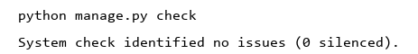
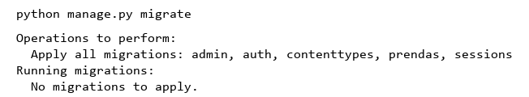
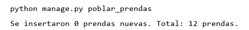
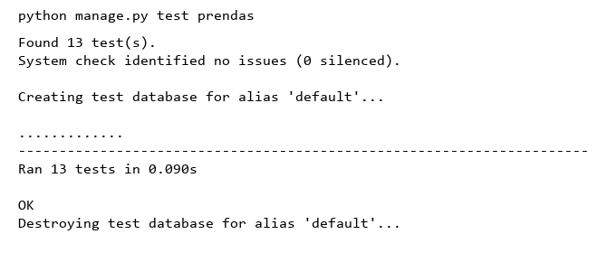
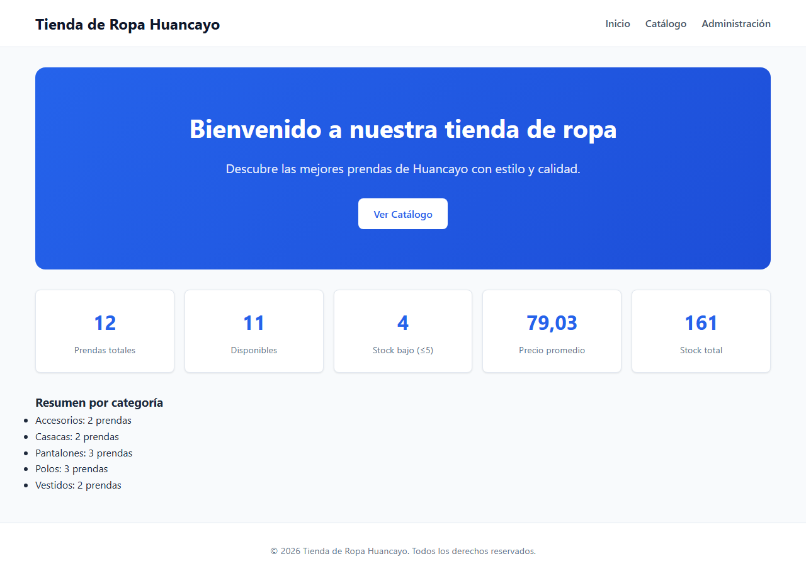
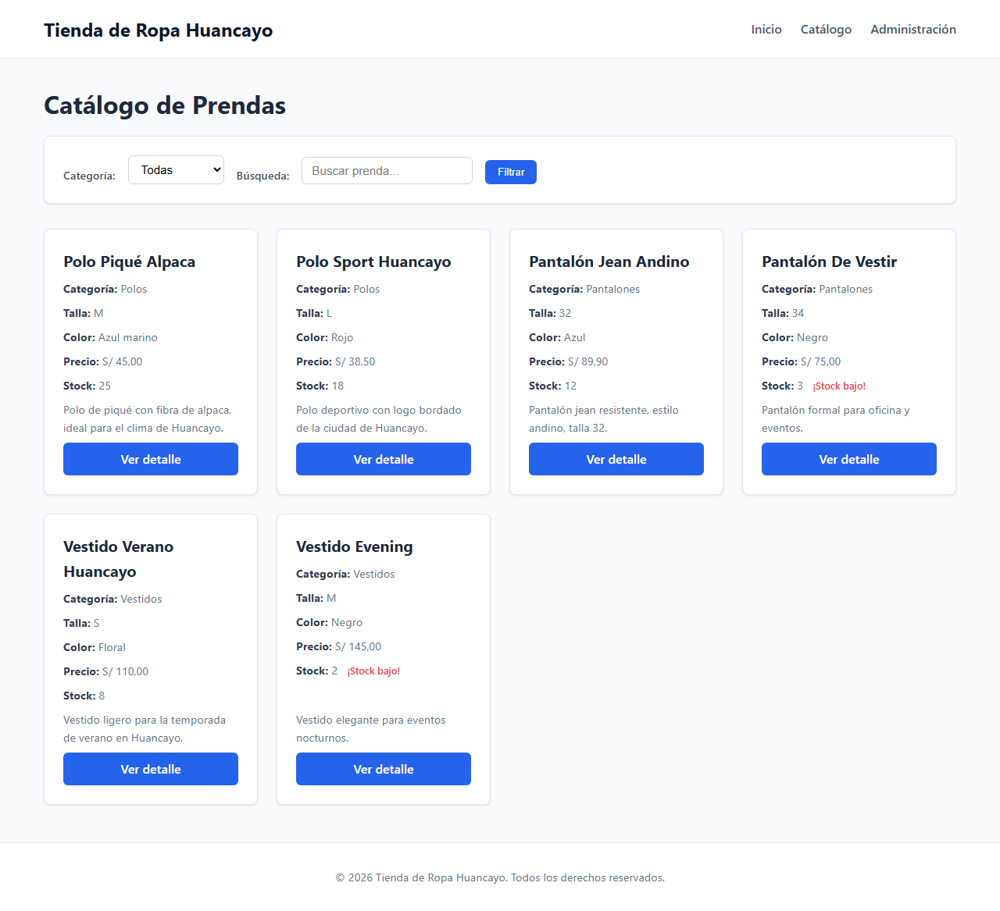
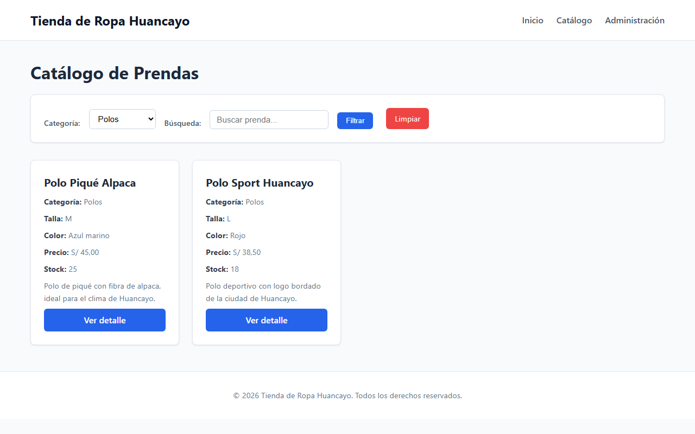
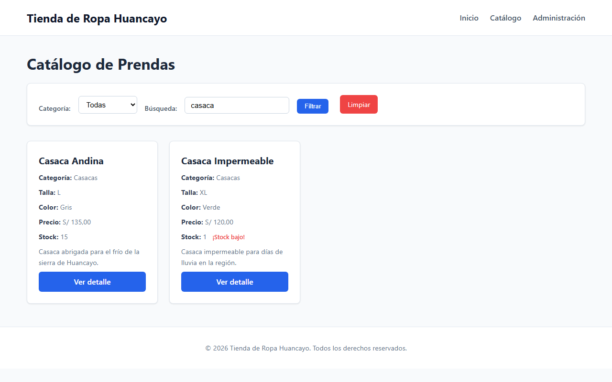
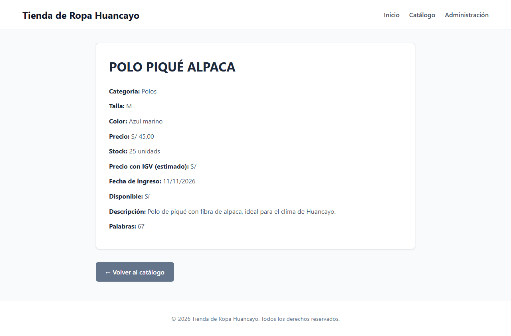
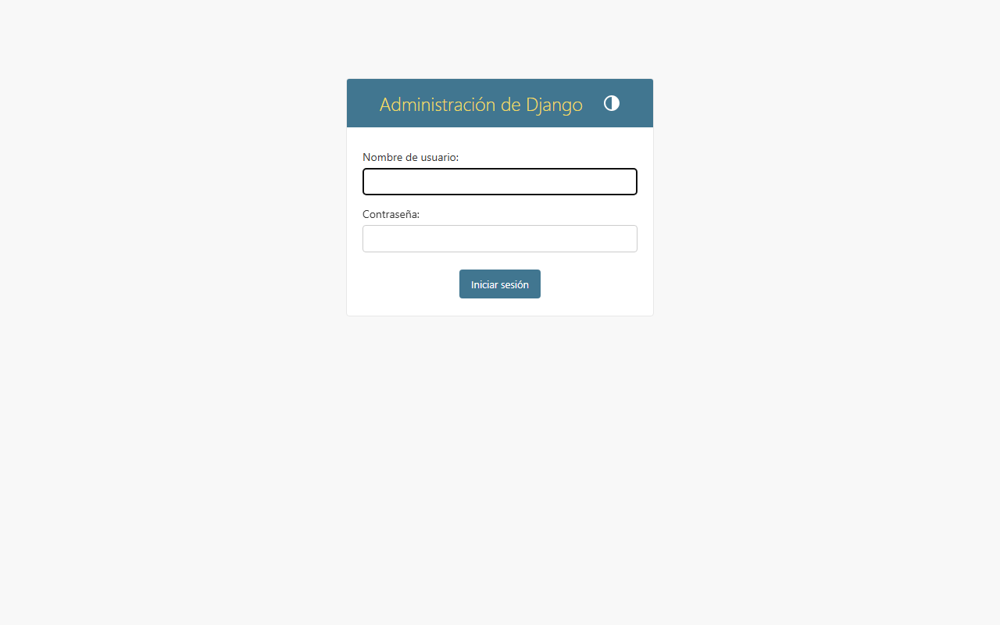

# Guía Práctica Semana 11 – Introducción a Django: Arquitectura MTV

**Asignatura:** ISO93A – Desarrollo de Aplicaciones Web  
**Institución:** Universidad Nacional del Centro del Perú (UNCP)  
**Unidad:** Semana 11 – Arquitectura MTV, URLs, Vistas (FBV/CBV), Plantillas y Modelos  
**Fecha:** 11.11.2026  
**Autor:** Estudiante ISO93A  
**Proyecto:** `tienda_ropa` – Catálogo de prendas para tienda de ropa de Huancayo

---

## 1. Objetivo

Desarrollar una aplicación web completa de catálogo de ropa usando **Django 5.2**, **Python 3.14** y **SQLite**, demostrando el patrón arquitectónico **MTV (Modelo–Template–Vista)**. La aplicación debe incluir:

- Modelo `Prenda` con `QuerySet` personalizado.
- Vistas basadas en función (FBV) y basadas en clase (CBV: `ListView`, `DetailView`).
- Plantillas con herencia, bloques, filtros y tags de Django.
- URLs con namespaces y `include()`.
- Panel de administración de Django.
- Comandos de gestión personalizados (`poblar_prendas`).
- Pruebas unitarias (≥13 pruebas).
- Evidencias capturas de pantalla (10 archivos PNG).

No se usan PostgreSQL, MySQL ni servicios externos. Toda la persistencia se realiza en **SQLite**.

---

## 2. Arquitectura MTV

El proyecto sigue estrictamente el patrón **MTV** de Django:

```
┌─────────────────────────────────────────────────────────────┐
│                     USUARIO (Navegador)                     │
└─────────────────────────────────────────────────────────────┘
                              │
                              ▼
┌─────────────────────────────────────────────────────────────┐
│                         URLs (urls.py)                      │
│  / → home()          /catalogo/ → PrendaListView           │
│  /prenda/<pk>/ →     /admin/ → Admin                        │
│         PrendaDetailView                                        │
└─────────────────────────────────────────────────────────────┘
                              │
              ┌───────────────┴───────────────┐
              ▼                               ▼
┌─────────────────────┐           ┌─────────────────────┐
│     VISTAS (V)      │           │   TEMPLATES (T)     │
│  views.py           │           │  base.html          │
│  - home() [FBV]     │           │  home.html          │
│  - PrendaListView   │           │  catalogo.html      │
│    [CBV ListView]   │           │  detalle.html       │
│  - PrendaDetailView │           │  404.html           │
│    [CBV DetailView] │           └─────────────────────┘
└─────────────────────┘
              │
              ▼
┌─────────────────────────────────────────────────────────────┐
│      MODELOS (M) + QUERYSET PERSONALIZADO (models.py)       │
│  - Prenda: nombre, categoria, talla, color, precio, stock,  │
│    descripcion, fecha_ingreso, disponible                   │
│  - PrendaQuerySet: disponibles(), por_categoria(),          │
│    stock_bajo(), buscar()                                   │
│  - Base de datos: SQLite (db.sqlite3)                       │
└─────────────────────────────────────────────────────────────┘
```

**Separación de responsabilidades:**
- **Modelo (`models.py`):** define la estructura de datos y lógica de consulta (`PrendaQuerySet`). No contiene lógica de presentación.
- **Vistas (`views.py`):** reciben la petición HTTP, consultan al modelo y pasan el contexto al template. No contienen lógica de negocio compleja; delegan filtros al `QuerySet`.
- **Plantillas (`templates/`):** solo se encargan de la presentación. No contienen lógica de negocio, solo etiquetas y filtros de Django.

---

## 3. Estructura de Carpetas

```
tienda_ropa/                 # Carpeta raíz del proyecto (Django)
├── .venv/                   # Entorno virtual (NO commitear)
├── .gitignore               # Ignora .venv/, db.sqlite3, __pycache__/
├── requirements.txt         # Django==5.2
├── manage.py                # Orquestador de Django
├── README.md                # Este archivo
├── db.sqlite3               # Base de datos SQLite (NO commitear)
├── capturas/                # Evidencias (10 capturas PNG)
│   ├── 01_check.png
│   ├── 02_migraciones.png
│   ├── 03_datos.png
│   ├── 04_pruebas.png
│   ├── 05_inicio.png
│   ├── 06_catalogo.png
│   ├── 07_filtro_categoria.png
│   ├── 08_busqueda.png
│   ├── 09_detalle.png
│   └── 10_admin.png
├── tienda_ropa/             # Paquete de configuración del proyecto
│   ├── __init__.py
│   ├── asgi.py
│   ├── settings.py          # Configuración: es-pe, America/Lima, SQLite
│   ├── urls.py              # URLs raíz con include() y namespace
│   └── wsgi.py
├── prendas/                 # Aplicación Django
│   ├── __init__.py
│   ├── admin.py             # Registro de Prenda en el admin
│   ├── apps.py
│   ├── migrations/
│   │   ├── __init__.py
│   │   └── 0001_initial.py  # Migración inicial aplicada
│   ├── management/
│   │   ├── __init__.py
│   │   └── commands/
│   │       ├── __init__.py
│   │       └── poblar_prendas.py  # Comando: inserta 12 prendas
│   ├── models.py            # Modelo Prenda + PrendaQuerySet
│   ├── tests.py             # 13 pruebas unitarias
│   ├── urls.py              # app_name='prendas', rutas con name=
│   ├── views.py             # home() [FBV], ListView, DetailView [CBV]
│   └── templates/
│       └── prendas/
│           ├── base.html    # Plantilla base con bloques
│           ├── home.html
│           ├── catalogo.html
│           ├── detalle.html
│           └── 404.html     # Página de error personalizada
└── static/
    └── css/
        └── style.css        # CSS propio, responsive
```

---

## 4. Instalación Paso a Paso

### Requisitos previos
- Python 3.10+ (probado con Python 3.14.6)
- pip

### Comandos

```powershell
# 1. Crear el entorno virtual
python -m venv .venv

# 2. Activar el entorno virtual (Windows)
.venv\Scripts\activate

# 3. Instalar dependencias
pip install -r requirements.txt

# 4. Aplicar migraciones (crea tablas en SQLite)
python manage.py migrate

# 5. Poblar la base de datos con 12 prendas de ejemplo (Huancayo)
python manage.py poblar_prendas

# 6. Crear superusuario para el panel de administración
python manage.py createsuperuser

# 7. Ejecutar el servidor de desarrollo
python manage.py runserver

# 8. Abrir en el navegador
#    http://127.0.0.1:8000/
```

---

## 5. Comandos de Verificación

| Comando | Propósito | Salida esperada |
|---------|-----------|-----------------|
| `python manage.py check` | Verifica configuración sin errores | `System check identified no issues (0 silenced).` |
| `python manage.py makemigrations --check --dry-run` | Verifica que no hay migraciones pendientes | `No changes detected` |
| `python manage.py test prendas -v 2` | Ejecuta las 13 pruebas unitarias | `OK` |
| `python manage.py shell -c "from prendas.models import Prenda; print(Prenda.objects.count())"` | Consulta registros en SQLite | `Total prendas en SQLite: 12` |

---

## 6. Tabla de Rutas

| Ruta | `name` | Vista | Tipo | Template | Descripción |
|------|--------|-------|------|----------|-------------|
| `/` | `prendas:home` | `home()` | FBV | `prendas/home.html` | Página de inicio con estadísticas |
| `/catalogo/` | `prendas:catalogo` | `PrendaListView` | CBV (ListView) | `prendas/catalogo.html` | Catálogo con filtros y paginación |
| `/prenda/<int:pk>/` | `prendas:detalle` | `PrendaDetailView` | CBV (DetailView) | `prendas/detalle.html` | Detalle de una prenda |
| `/admin/` | `admin:index` | AdminSite | CBV | admin | Panel de administración |

**Parámetros de consulta en `/catalogo/`:**
- `?categoria=Polos` — filtra por categoría
- `?q=casaca` — busca por nombre o descripción (combinado con `Q()`)

---

## 7. Filtros y Tags de Plantilla Usados

| Tag/Filtro | Uso | Ejemplo en template |
|------------|-----|---------------------|
| `` | Herencia de plantilla | `` |
| `` | Bloques sobrescribibles | `...` |
| `` | Bloque para CSS adicional | `` |
| `` | Bucle sobre colección | `` |
| `` | Alternativa si la colección está vacía | `` |
| `` / `` / `` | Condicionales | `Sí` |
| `` | Cicla entre valores | `` |
| `` | Resuelve URL por nombre | `` |
| `` | Fecha/hora actual | `` |
| `title` | Capitaliza palabras | `{{ prenda.nombre|title }}` |
| `upper` | Mayúsculas | `{{ prenda.nombre|upper }}` |
| `date` | Formatea fecha | `{{ prenda.fecha_ingreso|date:"d/m/Y" }}` |
| `floatformat` | Decimales | `{{ prenda.precio|floatformat:2 }}` |
| `pluralize` | Pluralización | `unidad{{ prenda.stock|pluralize:"s" }}` |
| `default` | Valor por defecto | `{{ prenda.descripcion|default:"..." }}` |
| `truncatewords` | Acorta texto | `{{ prenda.descripcion|truncatewords:15 }}` |
| `urlencode` | Codifica para URL | `{{ categoria_actual|urlencode }}` |
| `length` | Longitud | `{{ prenda.descripcion|length }}` |
| `add` | Suma | `{{ prenda.precio|add:"8.18" }}` |

---

## 8. Consultas ORM Ejecutadas

Las siguientes consultas se ejecutan en la aplicación y se pueden verificar en `manage.py shell`:

```python
from prendas.models import Prenda
from django.db.models import Avg, Count, Max, Sum, Q

# 1. objects.all() — todas las prendas
Prenda.objects.all()

# 2. filter() — filtro simple
Prenda.objects.filter(categoria='Polos')

# 3. exclude() — excluir
Prenda.objects.exclude(disponible=False)

# 4. get() — obtener una por pk
Prenda.objects.get(pk=1)

# 5. order_by() — ordenar
Prenda.objects.order_by('-fecha_ingreso')

# 6. exists() — verificar existencia
Prenda.objects.filter(nombre__icontains='alpaca').exists()

# 7. count() — contar
Prenda.objects.count()

# 8. disponibles() — QuerySet personalizado
Prenda.objects.disponibles()

# 9. por_categoria() — QuerySet personalizado
Prenda.objects.por_categoria('Casacas')

# 10. stock_bajo() — QuerySet personalizado
Prenda.objects.stock_bajo(limite=5)

# 11. buscar() — QuerySet personalizado con Q()
Prenda.objects.buscar('casaca')

# 12. annotate() — agregar conteo por categoría
Prenda.objects.values('categoria').annotate(total=Count('id'))

# 13. aggregate() — promedio de precios
Prenda.objects.aggregate(promedio=Avg('precio'))

# 14. aggregate() — suma de stock
Prenda.objects.aggregate(total=Sum('stock'))
```

**Lazy evaluation:** Los QuerySets de Django son perezosos (lazy). No se ejecuta la consulta SQL hasta que se itere el resultado o se llame a un método como `count()`, `first()`, `list()`, etc. Esto permite encadenar filtros (`filter().exclude().order_by()`) sin ejecutar consultas intermedias, optimizando el acceso a la base de datos.

---

## 9. Evidencias Visuales

Las capturas a continuación documentan cada punto obligatorio de la guía. Todas las imágenes están guardadas en la carpeta `capturas/`.

### 9.1. Verificación de configuración

**Figura 1.** Resultado de `python manage.py check` — sin errores detectados.



### 9.2. Migraciones

**Figura 2.** Migraciones ejecutadas correctamente con `python manage.py migrate`.



### 9.3. Población de datos

**Figura 3.** Comando `python manage.py poblar_prendas` ejecutado — 12 prendas insertadas en SQLite.



### 9.4. Pruebas unitarias

**Figura 4.** 13 pruebas unitarias ejecutadas con `python manage.py test prendas` — todas exitosas.



### 9.5. Página de inicio

**Figura 5.** Página de inicio (`/`) renderizada con la vista `home()` (FBV).



### 9.6. Catálogo de prendas

**Figura 6.** Catálogo de prendas (`/catalogo/`) renderizado con `PrendaListView` (CBV ListView) con paginación y filtros.



### 9.7. Filtrado por categoría

**Figura 7.** Catálogo filtrado por categoría (`?categoria=Polos`) mostrando solo prendas de ese tipo.



### 9.8. Búsqueda por nombre

**Figura 8.** Búsqueda en el catálogo (`?q=casaca`) usando el filtro `buscar()` del `PrendaQuerySet`.



### 9.9. Detalle de una prenda

**Figura 9.** Detalle de una prenda individual (`/prenda/1/`) renderizado con `PrendaDetailView` (CBV DetailView).



### 9.10. Panel administrativo

**Figura 10.** Panel de administración de Django (`/admin/`) con el modelo `Prenda` registrado.



---

> **Nota:** Todas las capturas fueron generadas con navegador real (Playwright + Chromium) apuntando al servidor local `http://127.0.0.1:8000/`, ejecutando el proyecto en entorno virtual con Django 5.2 y SQLite.

---

## 10. Mejoras Técnicas Aplicadas

1. **Paginación:** `PrendaListView` con `paginate_by = 6` y controles de paginación en el template.
2. **Búsqueda con `Q()`:** `PrendaQuerySet.buscar()` combina `nombre__icontains` y `descripcion__icontains` con operador OR.
3. **QuerySets en vistas:** `disponibles()` y `stock_bajo()` se usan en `home()` y `get_queryset()` de `ListView`.
4. **`get_object()` en `DetailView`:** Sobrescrito para manejo explícito de 404.
5. **404 personalizada:** `templates/404.html` con enlace de retorno al inicio.
6. **Admin mejorado:** `list_display`, `search_fields`, `list_filter`, `list_editable`, `list_per_page`, `ordering`.
7. **URLs sin hardcodeo:** Todas las rutas en templates usan `` (incluido el admin vía `admin:index`).
8. **Bloque `extra_css`:** `base.html` incluye `` para extensibilidad.
9. **Filtro `add`:** Se usa en `detalle.html` para calcular precio con IGV estimado.
10. **`annotate`/`aggregate`:** Se usan en `home()` para precio promedio, stock total y conteo por categoría.


